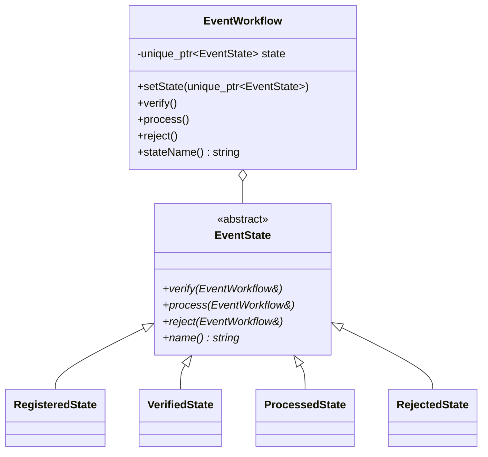
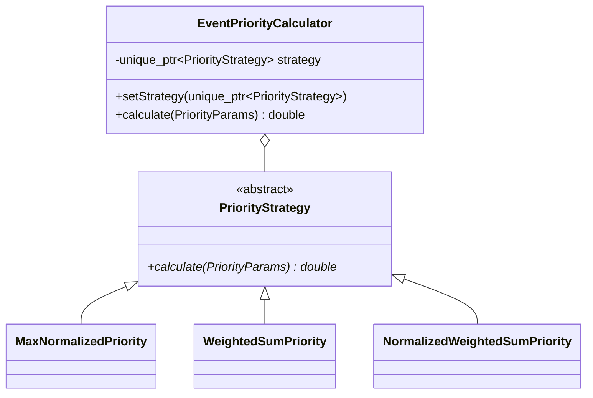
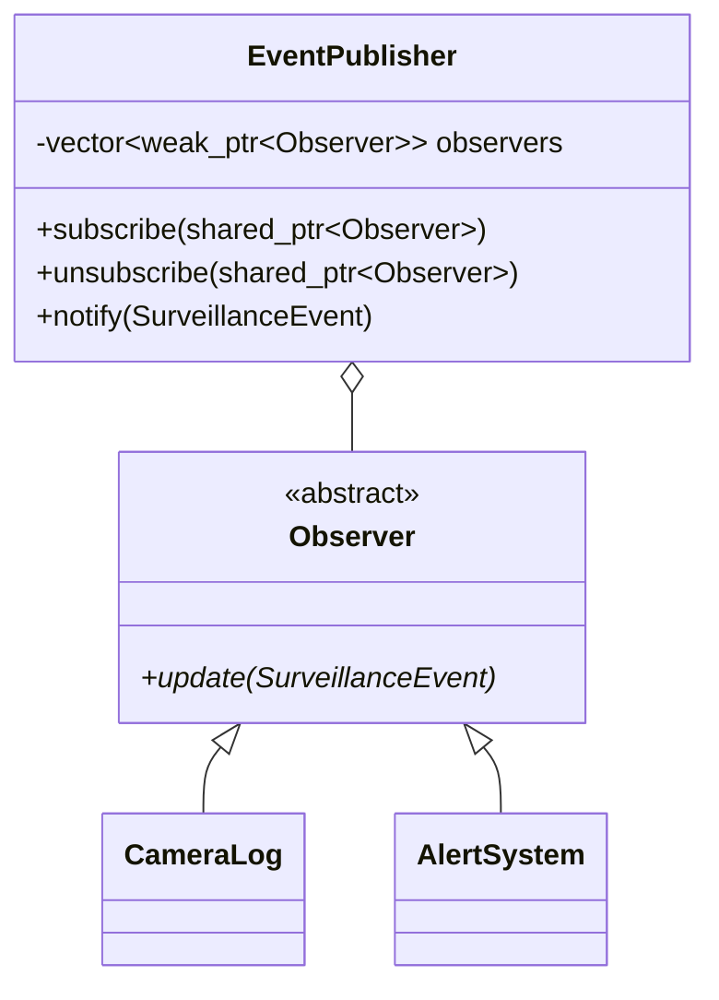
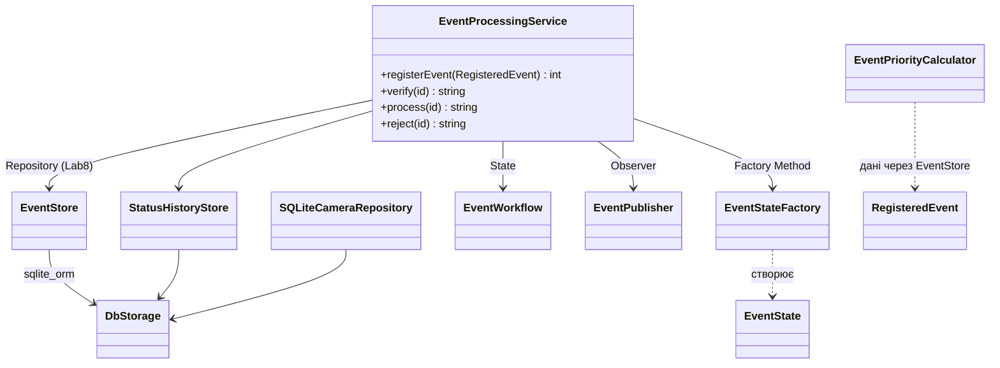

# Лабораторна робота №10 — Поведінкові патерни проєктування (C++), варіант 12

**Предметна область:** відеоспостереження.
C++20, CMake, vcpkg (manifest), SQLite, sqlite_orm, GoogleTest.

## Збирання та запуск

    cmake --preset default
    cmake --build build
    ctest --test-dir build --output-on-failure
    ./build/SurveillancePatterns

## 1. Початковий проєкт (Lab8)

Система відеоспостереження: **Camera** (1) — **RegisteredEvent** (N).
ORM-відображення через `sqlite_orm` (`Database.h`), Repository `ICameraRepository` /
`SQLiteCameraRepository` для камер, `EventStore` для подій, транзакції SQLite.

Предметну область, сутності та зв'язки збережено. У Lab10 перенесено ядро Lab8
(моделі, `Database.h`, Repository, `EventStore`, тестові дані) і розширено:

| Зміна | Призначення |
|---|---|
| `RegisteredEvent::status` (нова колонка, default `Registered`) | поточний стан події (State) |
| `EventStatusHistory` + таблиця + `StatusHistoryStore` | історія переходів (State) |
| `EventStore::update()` | збереження нового стану |

## 2. Реалізовані патерни

### 2.1 State — стани події (`EventState.h`)

Зареєстрована → Перевірена → Опрацьована; окремий стан — Відхилена.

| Поточний стан | verify | process | reject |
|---|---|---|---|
| Registered | → Verified | ✗ | → Rejected |
| Verified | ✗ | → Processed | → Rejected |
| Processed | ✗ | ✗ | ✗ |
| Rejected | ✗ | ✗ | ✗ |

✗ — `InvalidTransitionError`, стан не змінюється.



**Збереження та атомарність** (`EventProcessingService::changeState`):
1. подію отримано через `EventStore`, об'єкт стану створено з поля `status` (фабрика, див. 2.4);
2. перехід перевіряє State — недопустимий перехід кидає виняток **до** звернення до БД;
3. `storage.transaction(...)`: `EventStore::update` + `StatusHistoryStore::add`.
   Помилка будь-якої операції → ROLLBACK обох.

### 2.2 Strategy — пріоритет події (`PriorityStrategy.h`)

Параметри: важливість (severity 1..5), тривалість (с), час очікування на опрацювання (с).
Нормування до [0, 1]: важливість / 5, тривалість / 600, очікування / 3600 (з обмеженням зверху 1).
Ваги за замовчуванням: 0.5 / 0.2 / 0.3.

| Клас | Алгоритм |
|---|---|
| `MaxNormalizedPriority` | max(норм. важливість, норм. тривалість, норм. очікування) |
| `WeightedSumPriority` | w₁·важливість + w₂·тривалість + w₃·очікування |
| `NormalizedWeightedSumPriority` | Σ wᵢ·нормᵢ / Σ wᵢ |

Контекст `EventPriorityCalculator` зберігає `unique_ptr<PriorityStrategy>` і змінює
алгоритм через `setStrategy()` під час роботи. Дані для розрахунку беруться з сутності,
отриманої через `EventStore` (`toPriorityParams`); стратегії з БД не працюють.



### 2.3 Observer — сповіщення (`EventObserver.h`)

- **Події:** `EventRegistered` (реєстрація події), `CriticalEventConfirmed`
  (перевірено подію з severity ≥ 4).
- **Підписники:** `CameraLog` (журнал камери — фіксує всі події),
  `AlertSystem` (система попереджень — реагує лише на критичні).
- `EventPublisher` зберігає `weak_ptr<Observer>` (не продовжує життя підписників),
  `subscribe` / `unsubscribe`, знищені підписники видаляються через `std::erase_if`.
- Сервіс сповіщає **після** успішного COMMIT; при помилці переходу сповіщення немає.
  `EventPublisher` не містить логіки збереження даних.



### 2.4 Додатковий патерн — Factory Method (`EventStateFactory.h`)

Стан події зберігається в БД як рядок, а State працює з об'єктами класів.
Параметризований фабричний метод `EventStateFactory::create(status)` створює потрібний
об'єкт стану. Сервіс не знає про конкретні класи станів; невідомий рядок → `invalid_argument`.
Новий стан додається в одному місці.

### 2.5 Інтеграція в архітектуру



| Шар | Відповідальність |
|---|---|
| ORM (`Database.h`) | відображення структур на таблиці |
| `SQLiteCameraRepository`, `EventStore`, `StatusHistoryStore` | доступ до даних |
| `EventProcessingService` | бізнес-логіка, транзакції |
| State / Strategy / Observer / Factory Method | поведінка та взаємодія об'єктів |

Керування ресурсами: `unique_ptr` для стану та стратегії (контекст — єдиний власник),
`shared_ptr` для підписників, `weak_ptr` у видавця. `new` / `delete` не використовуються.

## 3. Обґрунтування вибору

- **State** — допустимі операції з подією залежать від її стану; замість `if/switch`
  у сервісі кожен стан — окремий клас, правила переходів локалізовано.
- **Strategy** — три алгоритми одного показника з однаковими параметрами;
  взаємозамінні та вибираються під час роботи без змін контексту.
- **Observer** — реєстрація / підтвердження критичної події мають викликати реакцію
  незалежних компонентів; сервіс не залежить від конкретних підписників.
- **Factory Method** — розв'язує конкретну проблему: відновлення об'єкта State з рядка,
  збереженого в БД.

## 4. Тестування (`tests/PatternTests.cpp`, 22 тести)

| Група | Сценарії |
|---|---|
| State (4) | основний шлях; Rejected з Registered і Verified; недопустимий перехід кидає виняток і не змінює стан; кінцеві стани блокують усі операції |
| Factory Method (2) | відновлення всіх 4 станів; невідомий статус |
| Strategy (6) | контрольні значення кожного алгоритму (напр. {2, 300, 1800} → 0.5 / 601 / 0.45); нормування понад межу; некоректні ваги; заміна стратегії під час роботи; параметри з сутності |
| Observer (3) | усі активні підписники отримують події; відписаний не отримує; знищений підписник видаляється |
| Інтеграція з БД (7) | перехід зберігає стан та історію; недопустимий перехід не змінює БД; **помилка запису історії → ROLLBACK стану**; відсутня подія; сповіщення при реєстрації; попередження лише для критичних подій; немає сповіщення при помилці |

Інтеграційні тести працюють з БД `:memory:`. Атомарність перевіряється через
впроваджений годинник (`Clock`), що кидає виняток під час формування запису історії —
після вже виконаного `update`.

```
[==========] 22 tests from 5 test suites ran.
[  PASSED  ] 22 tests.
```

## 5. Приклад роботи

```
=== OBSERVER: subscribe ===
[Camera log] Camera 1: event 16 (intrusion) registered
[Camera log] Camera 2: event 17 (motion) registered

=== STATE: allowed transitions ===
[Camera log] Camera 1: event 16 (intrusion) confirmed as critical
[ALERT] Critical event 16 (intrusion, severity 5) on camera 1
verify intrusion  -> Verified
process intrusion -> Processed
History of event 16:
  2026-11-23 10:06:01 | Registered -> Verified
  2026-11-23 10:06:01 | Verified -> Processed

=== STATE: rejected event ===
reject motion     -> Rejected
History of event 17:
  2026-11-23 10:06:01 | Registered -> Rejected

=== STATE: invalid transitions ===
reject processed  -> rejected: Processed event cannot be rejected
verify rejected   -> rejected: Event is rejected
process event 1   -> rejected: Event must be verified first
verify event 999  -> rejected: Event 999 not found

=== OBSERVER: AlertSystem unsubscribed ===
[Camera log] Camera 4: event 10 (intrusion) confirmed as critical
verify event 10   -> Verified
Alerts sent: 1, camera log entries: 4

=== STRATEGY: priority of events ===
Event 4 (vehicle_detected, severity 1, 20 s, waiting 1200 s)
  max of normalized      : 0.333
  weighted sum           : 364.500
  normalized weighted sum: 0.207
Event 5 (motion, severity 3, 60 s, waiting 1200 s)
  max of normalized      : 0.600
  weighted sum           : 373.500
  normalized weighted sum: 0.420
Event 7 (camera_offline, severity 4, 600 s, waiting 1200 s)
  max of normalized      : 1.000
  weighted sum           : 482.000
  normalized weighted sum: 0.700
```

## 6. Використання ШІ під час вибору додаткового патерну

- **Система ШІ:** Claude (Anthropic), модель Claude Opus 5.5.
- **Запит:** «Є C++20-проєкт відеоспостереження (Camera — RegisteredEvent, sqlite_orm,
  Repository). Реалізовано State (стани події зберігаються в БД рядком), Strategy
  (пріоритет події) та Observer (журнал камери, система попереджень). Який ще патерн GoF
  доцільно додати, щоб він розв'язував реальну проблему цього проєкту, а не був
  штучним? Наведи варіанти з обґрунтуванням.»
- **Отримані рекомендації:**
  1. *Factory Method* — створення об'єкта State з рядка `status`, прочитаного з БД;
     також можливий вибір стратегії за назвою.
  2. *Command* — операції verify/process/reject як об'єкти-команди з чергою для оператора
     та журналом дій.
  3. *Facade* — спрощений інтерфейс над Repository, State, Observer.
  4. *Decorator* — додавання поведінки до стратегій (наприклад, підвищення пріоритету
     вночі).
- **Обраний патерн:** Factory Method. Без нього сервіс мусив би містити `if/switch` за
  рядком статусу, що суперечить ідеї State. Фабрика усуває цю конкретну проблему одним
  невеликим класом. Command і Decorator у межах завдання не мають реальної потреби
  (черги операцій чи додаткових правил пріоритету в постановці немає), а Facade фактично
  вже виконує роль сервісу `EventProcessingService`.
